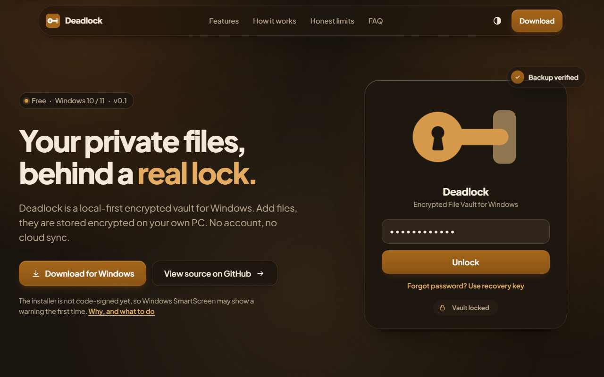
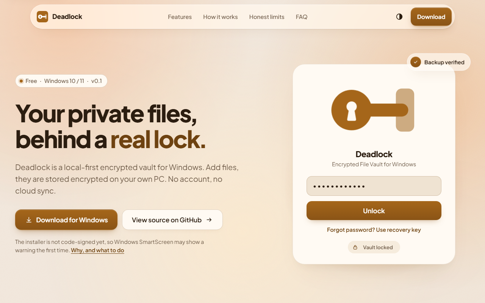
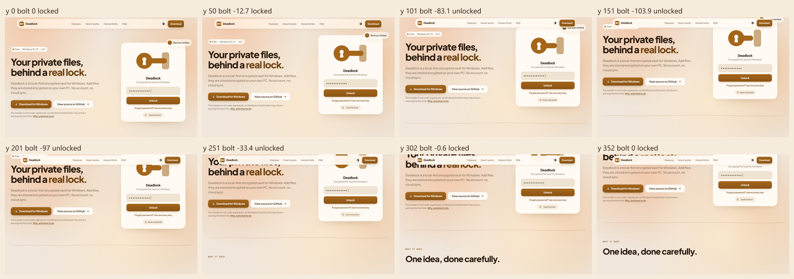
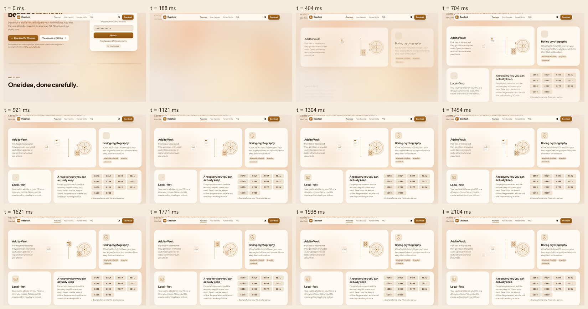
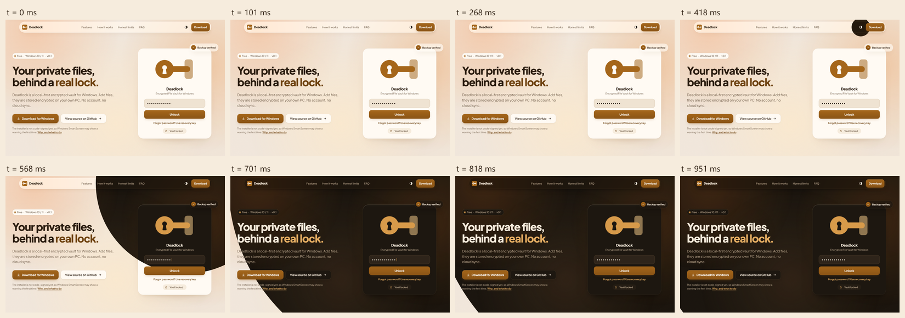

<div align="center">



# 🔐 Deadlock — Encrypted File Vault

### *Your private files, behind a real lock.*

[](https://github.com/prnv-dev/DeadLock/releases)
[](https://github.com/prnv-dev/deadlock-web)
[](https://libsodium.gitbook.io/doc/)
[](https://en.wikipedia.org/wiki/Argon2)
[](./shots/lighthouse/summary.json)
[](LICENSE)

<br/>

**[⬇️ Download Installer (114.8 MB)](#-direct-download--verification)** •
**[✨ Features](#-core-features)** •
**[🧪 Tech Architecture](#-architecture--animation-system)** •
**[📊 Verification Suite](#-verification-commands)** •
**[🌐 GitHub Source](https://github.com/prnv-dev/DeadLock)**

---

</div>

<br/>

## 🎯 What is Deadlock?

> **Deadlock is a free, local-first encrypted file vault for Windows 10 & 11.**  
> Pick files or folders and lock them down behind strong, peer-reviewed cryptography. No accounts, no subscriptions, no telemetry, and no cloud sync to trust. Your files stay encrypted on your own machine.

<br/>

<div align="center">
  <table>
    <tr>
      <td width="50%" align="center">
        <b>🌙 Dark Theme (Warm Obsidian & Brass)</b><br/><br/>
        
      </td>
      <td width="50%" align="center">
        <b>☀️ Light Theme (Warm Paper & Amber)</b><br/><br/>
        
      </td>
    </tr>
  </table>
</div>

<br/>

---

## ⚡ Core Features

```
  ┌───────────────────┐       ┌───────────────────────┐       ┌───────────────────┐
  │   Add to Vault    │ ───►  │  XChaCha20-Poly1305   │ ───►  │   Offline Key     │
  │  Drag & drop any  │       │   Argon2id password   │       │ 14-group recovery │
  │   file or folder  │       │  derivation (libsodium│       │  backup you keep  │
  └───────────────────┘       └───────────────────────┘       └───────────────────┘
```

| Feature | Description | Behind the Scenes |
| :--- | :--- | :--- |
| **🛡️ Boring Cryptography** | No homemade ciphers. Industry-standard primitives. | **XChaCha20-Poly1305** authenticated encryption + **Argon2id** memory-hard key derivation built on **libsodium**. |
| **💾 Local-First & Sovereign** | Your vault is simply a directory on your PC or external drive. | Zero cloud sync. Uninstalling Deadlock never removes your encrypted vault. |
| **🔑 Real Offline Recovery** | Lost your master password? You can still regain entry. | 14-group mnemonic recovery key. Saved offline, regenerated instantly. |
| **⚡ Backups that Verify** | Backup vault to a USB drive with automatic integrity check. | Copies encrypted vault and checks every file byte-for-byte against the original. |
| **🔒 Auto-Lock & Clipboard Shield** | Auto-locks when you step away from your PC. | Sensitive data copied to clipboard is automatically wiped after 30s and excluded from Windows clipboard history. |
| **🤫 Quiet Lock Screen** | Locked means locked. Minimal surface area. | The lock screen gives nothing away about vault location or what files are stored inside. |

<br/>

---

## ⬇️ Direct Download & Verification

The Windows standalone installer is hosted directly on this site with **no runtime external network dependencies**:

<div align="center">

| File | Size | Platform | SHA-256 Hash |
| :--- | :--- | :--- | :--- |
| `Deadlock-Setup-0.1.0.exe` | **114.8 MB** | Windows 10 / 11 | `3ccd2b01b35fd7918215a5a57b3adc213736c93dd12322f77ca89386618047b2` |

</div>

### 🔍 Verify Your Download in PowerShell

The hash on this page must match the one Windows prints:

```powershell
Get-FileHash .\Deadlock-Setup-0.1.0.exe -Algorithm SHA256
```

> [!NOTE]
> **Windows SmartScreen Note:** The installer is downloaded directly from this site and is not code-signed yet, so Windows SmartScreen may show a warning on first run. If you downloaded from this site, click **More info**, then **Run anyway**. You can always verify the SHA-256 hash or inspect the source code.

<br/>

---

## 🎨 Interactive Motion & Frame Breakdown

The web landing page uses progressive enhancement: HTML & CSS provide instantaneous first paint, followed by hardware-accelerated GSAP animations and Lenis smooth scrolling.

<div align="center">
  <table>
    <tr>
      <td width="33%" align="center">
        <b>🔩 Deadbolt Scroll Scrub</b><br/><br/>
        
      </td>
      <td width="33%" align="center">
        <b>📦 Bento Wave Reveal</b><br/><br/>
        
      </td>
      <td width="33%" align="center">
        <b>🌗 View-Transition Theme Switch</b><br/><br/>
        
      </td>
    </tr>
  </table>
</div>

<br/>

---

## 🛠️ Development & Tooling

Built with **Vite 8**, **TypeScript**, and **Vanilla CSS tokens** (no Tailwind dependency).

```bash
# 1. Install dependencies
npm install

# 2. Launch development server with automatic pre-info generation
npm run dev

# 3. Typecheck, contrast-gate, and build production distribution in dist/
npm run build

# 4. Confirm the installer exists in dist/ and matches the built HTML hash
npm run check:download

# 5. Preview production build locally on strict port 4173
npm run preview
```

<br/>

---

## 📊 Automated Verification Suite

Every aspect of the site is tested headlessly using Playwright and Chromium:

```bash
npm run verify   # Runs build + shots + frames + reduced + lighthouse in sequence
```

| Script | Purpose | Output Target |
| :--- | :--- | :--- |
| `npm run contrast` | Enforces WCAG AA contrast on every brand token pair in light & dark modes | Console validation |
| `npm run check:download` | Asserts installer integrity and SHA-256 match in built HTML | Console verification |
| `npm run shots` | Responsive screenshot matrix at 360, 390, 768, 1280, and 1920 viewport widths | `shots/*.png`, `layout-report.json` |
| `npm run frames` | Frame-by-frame recordings of key interactive state transitions | `shots/frames/` |
| `npm run reduced` | Verifies `prefers-reduced-motion` and no-JS fallback behaviors | `shots/reduced/` |
| `npm run lighthouse` | Automated multi-run Lighthouse performance audit | `shots/lighthouse/summary.json` |
| `npm run perf` | Measures rAF frame times under synthetic CPU throttling | `shots/perf-*.json` |

<br/>

---

## 🏛️ Architecture & Performance Principles

<details>
<summary><b>📖 Expand Architecture Details</b></summary>
<br/>

1. **Instant First Paint (CSS Only)**  
   The critical intro sequence (nav slide, masked heading rise, and initial card scale) runs via pure CSS keyframes. First contentful paint (FCP) never waits on JavaScript execution.
2. **Deferred Script Hydration (`src/main.ts`)**  
   The main interactive bundle (`src/app.ts`) is deferred until first user interaction (`pointerdown`, `scroll`, `keydown`) or 1.2s post-load, safeguarding 100/100 Lighthouse performance on mobile devices.
3. **Single Source of Truth (`src/config.ts`)**  
   Download paths, product versions, and outbound links are managed in a single module and injected statically into HTML via the custom `deadlockHtml` plugin.
4. **Self-Contained Bundles**  
   Single CSS output inlined into `dist/index.html` at build time to save render-blocking network requests on mobile connections.

</details>

<br/>

---

<div align="center">

Made with care by **[prnv-dev](https://github.com/prnv-dev)** • 2026

*Deadlock is free, open source, and built for user privacy.*

</div>
